# zmk-config-roBa



## キーマップ・コンボをUSBで直接変更する

この構成は、DYA Studio互換のRuntime Comboに対応しています。最初に左右の対応ファームウェアを書き込むと、以後はコンボの変更ごとにビルドする必要はありません。

### 初回のファームウェア書き込み

この作業でローカル生成した左右のUF2は `artifacts/runtime-combo/`、Windowsアプリは `tools/roba-keymap-tool/release/roBa Keymap Tool 1.2.0.exe` にあります。生成済みUF2を使う場合は、以下の手順2から進められます。これらの生成物はGit管理対象外です。

1. この変更を含むリポジトリでGitHub Actionsのビルドを実行し、`firmware` をダウンロードします。既存アプリのビルドボタンがコミットするのはキーマップのみなので、初回は `config/west.yml`・`boards`・`drivers`・`zephyr/module.yml`・ワークフローなど、今回の変更全体が必要です。
2. 左側をUSBに接続し、RSTをダブルタップして、`roBa_L-...uf2` をXIAOのドライブへコピーします。
3. 右側も同じ方法で `roBa_R-...uf2` を書き込みます。今回はZMK本体を更新するため、左右を同じ構成にそろえてください。
4. 通常起動した右側をUSBにつなぎます。Studio接続時はRSTを押しません。

通常の移行に `settings_reset` は不要です。これはBluetoothペアリング等も消去するため、接続問題の調査時だけ使用してください。すでにStudioで編集していた通常キーマップは保存内容が優先されます。

### Windowsアプリ

```powershell
cd tools/roba-keymap-tool
npm ci
npm start
```

1. 左の「本体の設定」→「USBで接続」で、右側roBaのポートを選択します。
2. 「コンボ」タブでコンボを選び、組み合わせるキー、動作、対象レイヤー、同時押し判定時間などを編集します。未設定のスロットを選ぶと新規作成できます。
3. すべてのキーを離して「反映して試す」を押します。変更は本体で直ちに有効になります。
4. 設定が決まったら「本体へ保存」を押します。電源を切った後も残ります。

通常キーは「本体の設定」内の「キーマップ」タブで編集できます。

1. レイヤーを選び、変更したいキーをクリックします。
2. 動作と引数を選び、「反映して試す」を押します。
3. 動作を確認して「キーマップを保存」を押します。保存は全レイヤーの変更が対象です。

前回のRuntime Combo対応ファームウェアを導入済みなら、通常キー編集のための再書き込みは不要です。アプリを1.2.0に更新してください。

「本体から再読み込み」は現在の動作設定を読みます。「最後の保存状態へ戻す」は、今回反映した未保存の変更を取り消します。「削除」も保存するまでは一時的です。「コンボ」タブの保存・取り消しはRuntime Combo全体、「キーマップ」タブは通常キーマップ全体が対象です。互いの設定とBluetooth設定には影響しません。画面で編集しただけでは反映されないため、保存の前に「反映して試す」を押してください。

通信エラー時は、変更が一部だけ反映されている場合があります。再接続して本体から読み直してください。書き込みは自動再試行しません。DYA Studioや他のアプリが同じUSBポートを使っている場合は、先に切断してください。

`npm run build` でWindows用のポータブルEXEを作成できます。出力先は `tools/roba-keymap-tool/release/` です。

### DYA Studioを使う場合

Chrome/Edgeで [DYA Studio](https://studio.dya.cormoran.works/) を開き、右側にUSB接続してください。このアプリの「DYA Studioを開く」からも開けます。通常のキー割り当ては本アプリに加え、DYA Studioまたは [ZMK Studio](https://zmk.studio/) で変更できます。アプリとブラウザは同時接続できません。

### 保存場所と対応範囲

| 操作 | 保存先・反映方法 |
| --- | --- |
| アプリの「キーマップ」「コンボ」画面 | ローカルの `.keymap`。反映には再ビルド・書き込みが必要 |
| アプリの「本体の設定」画面 | USBで本体に反映。各タブの保存ボタンで永続化 |
| Studioでの通常キー編集 | 本体のStudioキーマップ設定 |

本体と `.keymap` は自動同期しません。本体に保存したコンボは、ファームウェアの初期設定より優先されます。`.keymap` を再ビルドしただけでは、変更済みスロットの設定は戻りません。初期設定へ戻す場合はRuntime Comboの対応Web UIの「Reset to Default」を使用します。アプリの「最後の保存状態へ戻す」とは別の操作です。

- コンボは最大16個、1個につき2〜16キーです。既存の9個をスロット0〜8に引き継いでいます。
- 同時押し判定時間・直前入力からの待ち時間は、0で共通設定を継承します。
- 割り当てられる動作はファームウェアに組み込まれているものです。既存のマクロの割り当てはできますが、マクロの内容・長押し判定・トラックボール設定を動作中に編集する機能は、この変更には含みません。
- 通信方式はUSBです。新しいキー動作の実装や機能の追加は、引き続きファームウェアの更新が必要です。
- 実機でのUSB接続・入力・電源再投入後の保持は、対応ファームウェアを書き込んだroBaで確認してください。自動テストではUSBの応答を模擬しています。

### 構成と開発

ZMKは [cormoranのCustom Studio Protocol派生版](https://github.com/cormoran/zmk)、コンボは [Runtime Combo](https://github.com/cormoran/zmk-feature-runtime-combo)、保存機能は [Custom Settings](https://github.com/cormoran/zmk-feature-custom-settings) を使用し、`config/west.yml` でコミットを固定しています。アプリの通信定義も対応する版を `vendor/` に固定しています。

Zephyr 4.1への移行に伴い、ボード指定は `xiao_ble//zmk` です。トラックボールドライバーは元の設定を保った互換コピーを `drivers/roba-pmw3610/` に置いています。`MOUSE` レイヤーの内部ノード名は `auto_mouse` に変更しましたが、表示名・番号4・キー配列は維持しています。

```powershell
cd tools/roba-keymap-tool
npm test
npm run test:electron
```

テストは通信フレーム、コンボの保存・取り消し、異常時の切断、既存キーマップの保持、画面操作を確認します。Electronの確認は非表示ウィンドウで行い、USBへの書き込みは行いません。

ローカルのファームウェアビルドはWSL Ubuntu・Zephyr SDK 0.17.0で確認しています。左右および `settings_reset` がビルド対象です。右側の使用量はFlash約316 KB、RAM約114 KBです。SDK 0.17.4では、このZephyr版のpicolibcと型定義が衝突したため、再現時は0.17.0を使用してください。
